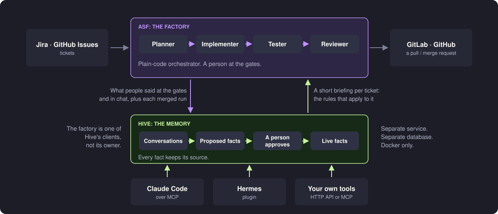

# Hive

**Shared memory for a team's AI coding agents.** When someone corrects an agent ("we don't add a phone field to
that form", "always run the migration check first"), Hive remembers it, asks a person to approve it, and hands it
to every agent that works on a related task later, on any teammate's machine.

Status: an MVP, used daily by one small team. "Hive" is a working name. Licensed under Apache-2.0.

## What we're trying to do

AI agents read code well. What they don't know is what your team decided last week. Today:

1. **A correction is given once, then lost.** You fix an agent's plan in review. The next ticket makes the same
   mistake, because nothing wrote it down.
2. **What one person's agent learns stays on that laptop.** Session memory is local. Your teammate's agent, and any
   automated pipeline, never hear about it.
3. **Shared instruction files grow, load in full, and go stale quietly.** A `CLAUDE.md` or `AGENTS.md` works at
   twenty rules. At two hundred, every agent reads all of them on every task, and nobody notices when one is out
   of date.

Hive is one service your whole team's agents connect to. It turns what people tell agents into short **facts**,
has a person approve them, and gives each agent only the facts that matter for the task in front of it.

## Why would I use this?

Use Hive if you have more than one person (or one person plus an automated pipeline) using AI agents on the same
codebases, and you are tired of repeating yourself.

- **You say it once.** A correction you give in a chat or a plan review becomes a proposed fact. Nobody has to go
  and edit a file.
- **A person checks it before it spreads.** Facts meant for the team wait in a review queue. One agent's bad guess
  can't reach everyone. Notes only for you skip review and stay private.
- **Agents get only what's relevant.** At the start of a task an agent asks for a short briefing (a few hundred
  tokens) instead of loading every rule the team has ever written.
- **You can always ask "why does the agent believe that?"** Every fact keeps where it came from (who said it, in
  which conversation or file). Agents cite facts as `[hive:1a2b3c4d]`, so you can look them up.
- **Changing a decision is one edit.** An old fact is replaced in one place, with its history kept. Nothing is
  deleted.

When you *don't* need it: a solo developer on one repo with a short `CLAUDE.md` is fine without Hive.

## How it fits with ASF

Hive is a separate service. The [Agentic Software Factory](https://github.com/bennybrau/agentic-software-factory)
(ASF) turns tickets into pull requests with a small team of agents. It is one of Hive's clients, not its owner:
Claude Code, Hermes and your own tools connect to the same memory.



1. A person corrects an agent: in an ASF plan review, an ASF run chat, a Hermes chat, or by asking Claude Code to
   remember something.
2. Hive's background worker reads that conversation and proposes a fact (a few cents of model time per
   conversation at most; most conversations propose nothing).
3. A **curator** (a person with review rights) approves it in Hive's web dashboard and picks who gets it.
4. The next agent that starts a related task gets the fact in its briefing and cites it.

### Words you'll see

| Word | Meaning |
|---|---|
| **Fact** | One short, durable statement, like "The clinic form never asks for a phone number." |
| **Candidate** | A proposed fact waiting for review. Agents don't see it yet. |
| **Curator** | A person who approves, fixes or rejects candidates in the dashboard. |
| **Level** | Who gets a fact: *Just me* (private), *Repository*, *Team*, or *Everyone*. The curator picks it. |
| **Briefing** | The short list of facts, past work and pointers an agent gets at the start of a task. |
| **Episode** | Raw material Hive learns from: a chat session, an ASF run, a plan-review note. |

## Set it up on a host machine

You need one machine that stays on: a desktop, a mini-PC, a server, or a cloud VM. Your teammates' agents connect
to it over the network.

### 1. Install the prerequisites

- **Docker** with Compose v2: [Docker Desktop](https://www.docker.com/products/docker-desktop/) or
  [Rancher Desktop](https://rancherdesktop.io/) on a Mac, Docker Engine on Linux. Check: `docker compose version`.
- **curl** (already on macOS and most Linux).
- **A Claude Code token** for the fact agent (the background worker that proposes facts). On any machine with
  Claude Code: run `claude setup-token` and keep the token it prints. You can skip this and add it later.
- Optional, for search by meaning instead of keywords only: [Ollama](https://ollama.com/) running on the host.

### 2. Run the installer

```bash
curl -fsSL https://raw.githubusercontent.com/bennybrau/hive/main/scripts/install.sh | bash
```

It asks a few questions. Every question has a default in brackets; press **Enter** to take it. The ones to think
about:

- **Listen on**: keep `127.0.0.1` if only this machine (and an ASF on it) will use Hive. Pick `0.0.0.0` or the
  Tailscale address it offers when teammates connect from their own machines.
- **Fact agent**: `claude` and paste the token from step 1, or `skip` to set it later in the dashboard.
- **Teammates' names**: a comma list, for example `ann,bob`. Each gets their own token. Add `asf-factory` here if
  you will connect ASF.

It installs into `~/hive`, starts everything, and prints a summary. **Copy the summary somewhere safe:** it shows
each token once.

### 3. Open the dashboard

Open the URL from the summary (default **http://127.0.0.1:8800**) and sign in with your curator token. You land
on Hive's home page. The **Review** page is where candidates will show up.

### 4. Add your repositories

In the dashboard, go to **Repos → Add by URL** and add every GitHub repository your agents work on (add an access
token for private ones). Hive reads their docs and commits so agents can search them. ASF's runs are only
accepted for repos Hive knows, so add those first.

### 5. Connect your agents

The installer's summary printed a ready-to-paste line per person. They look like this:

- **Claude Code** (on each person's machine):

  ```bash
  claude mcp add --transport http hive http://<hive-host>:8800/mcp \
    --header "Authorization: Bearer <token>"
  ```

  Check with `claude mcp list`. More: [docs/CLAUDE_CODE.md](docs/CLAUDE_CODE.md).
- **Hermes** (on each person's machine):

  ```bash
  curl -fsSL https://raw.githubusercontent.com/bennybrau/hive/main/scripts/install.sh \
    | bash -s -- join --url http://<hive-host>:8800 --token <token>
  ```

  What gets sent and who sees it: [docs/JOINING.md](docs/JOINING.md).
- **ASF**: in ASF, open **Settings → Send finished work to Hive?** and enter:
  - Hive address: `http://host.docker.internal:8800` when ASF runs on the same machine, else Hive's network address.
    On Linux (not Docker Desktop or Rancher Desktop), Hive must listen beyond `127.0.0.1` for ASF's containers to
    reach it: answer `0.0.0.0` to **Listen on**, and keep port 8800 closed to the internet.
  - Hive token: the `asf-factory` token from the summary.
  - Hive dashboard address: the URL you opened in step 3.

### 6. Check it works

1. In a repo you added, ask Claude Code or Hermes: *"Remember for this repo: we name test files `*.spec.ts`."*
2. In the dashboard, open **Review**. The fact is waiting there. Approve it.
3. Start a new session in the same repo and ask *"How do we name test files?"* The answer should cite
   `[hive:…]`.

### Day to day

```bash
~/hive/install.sh doctor      # health check: one line per check, ✗ means something to fix
~/hive/install.sh upgrade     # move to the latest release
~/hive/install.sh             # re-run to change an answer; your data is kept
```

Hive backs up its database every night (03:00 UTC by default, last 7 days kept). Restore and backup options:
[Backups and restore](#backups-and-restore).

**Hive not answering?** Check that Docker itself is running first (`docker info`). After a reboot, Docker Desktop
or Rancher Desktop may need to be started again; Hive's containers come back on their own once it is.

Every installer question, its environment variable for scripted installs, and how to run a second Hive on one
host: [docs/INSTALL.md](docs/INSTALL.md).

## Learn more

- [docs/JOINING.md](docs/JOINING.md): for a teammate joining a Hive. What is sent, who sees it, how to turn it off.
- [docs/manual/](docs/manual/README.md): the dashboard, page by page (Facts, Search, Repos, Review, Stats).
- [docs/HIVE-EXPLAINER.md](docs/HIVE-EXPLAINER.md): a short explainer to share with your team.
- [docs/EXPERIMENT_RESULTS.md](docs/EXPERIMENT_RESULTS.md): what we've measured so far, with its caveats.
- [docs/DESIGN-NOTES.md](docs/DESIGN-NOTES.md), [docs/MVP-PLAN.md](docs/MVP-PLAN.md),
  [docs/GLOSSARY.md](docs/GLOSSARY.md), [docs/API.md](docs/API.md): design decisions, plan, vocabulary and the
  HTTP API.

## For contributors

### Layout

```
apps/hive/       TypeScript (Fastify) service + jobs; owns Postgres (pgvector + full-text search); MCP endpoint at /mcp
apps/worker/     hive-worker: background jobs (distill with `claude -p` or a local model, evals, experiment)
apps/dashboard/  React dashboard, served by the service
plugins/hive/    Python memory-provider plugin for Hermes (dir name = provider name)
scripts/         setup, tests, e2e, distill eval, experiment harness
docs/            design, plan, API, user manual
```

### Run from a checkout

Needs Docker, Node 22+ and pnpm.

```bash
pnpm install
scripts/setup.sh --curator-user alice --curator-name alice-laptop  # .env, stack up, prints HIVE_URL + curator token
curl -s 127.0.0.1:8800/health                                     # {"ok":true,"db":"up",...}
docker compose exec hive node dist/cli/mint-token.js --name bob-laptop --user bob   # one token per agent
```

The dev stack's Postgres is on host port 5544, so it doesn't clash with ASF's on 5432.

### Tests

```bash
scripts/test.sh          # service: vitest against the compose Postgres (throwaway hive_test db)
scripts/test-plugin.sh   # Hermes plugin: pytest against Hermes' own MemoryProvider code
pnpm typecheck
scripts/redeploy.sh      # rebuild + restart the hive container after code changes
scripts/e2e-plugin.sh    # real Hermes session through the plugin against the running hive (one model call)
```

### Manual install from release images

Published images: `ghcr.io/bennybrau/hive` (service + dashboard) and `ghcr.io/bennybrau/hive-worker`, for
linux/amd64 and linux/arm64. Each `vX.Y.Z` release attaches the compose file, `hive.env.example` and
`hive-plugin.tar.gz` (the Hermes plugin, top directory `hive/`).

```bash
mkdir hive && cd hive
V=v0.2.0; R=https://github.com/bennybrau/hive/releases/download/$V
curl -fsSL -o docker-compose.yml $R/docker-compose.release.yml
curl -fsSL -o .env $R/hive.env.example
# in .env: POSTGRES_PASSWORD=$(openssl rand -hex 24), HIVE_SECRET_KEY=$(openssl rand -hex 32), HIVE_VERSION=0.2.0
docker compose up -d --wait
docker compose exec hive node dist/cli/mint-token.js --name alice-laptop --user alice --role curator   # your token
docker compose exec hive node dist/cli/mint-token.js --name hive-worker --user hive-worker --role worker
# put that token in .env as HIVE_WORKER_TOKEN, then:
docker compose up -d --wait hive-worker
```

Repos from a host directory: set `HIVE_REPOS_HOST_ROOT` in `.env`. Ollama in a container instead of on the host:
`OLLAMA_URL=http://ollama:11434` and `docker compose --profile ollama up -d`. Upgrade: change `HIVE_VERSION`, then
`docker compose pull && docker compose up -d --wait`.

### Meaning search (Ollama)

Embeddings come from Ollama on the host, reached from the container at `host.docker.internal:11434`:

```bash
brew install ollama && ollama serve        # or the Ollama app
ollama pull nomic-embed-text
```

Without it Hive still works, keyword-only; `/v1/status` shows `embeddings.state`.

### Backups and restore

The `backup` service runs `pg_dump` every night at `HIVE_BACKUP_TIME` (default 03:00, in `TZ`, default UTC). The
dumps are `hive-YYYYMMDD-HHMM.dump` (`pg_dump -Fc`, mode 600) in the `hive-backups` volume, or in `HIVE_BACKUP_DIR`
on the host when set. It keeps the newest dump of each of the last 7 days and of each of the last 4 Sundays, and
always the newest one; other files there are left alone. Set `HIVE_BACKUP_COPY_DIR` to a second host directory (a
NAS, a synced folder) to get a copy of each dump there, with the same retention. `HIVE_BACKUPS=off` turns it off.

Take one now: `scripts/backup-now.sh` in a checkout, or from the install directory
`docker compose -p <project> run --rm --no-deps -T backup once`. `install.sh doctor` warns when the newest dump is
over 26 hours old, or when there is none.

Practice a restore now and then: `scripts/restore.sh latest` restores the newest dump into a new database
`hive_restore_<timestamp>`, leaving the live one alone, prints each table's rows restored and live, and prints the
command to drop it. `scripts/restore.sh <file> --into hive --yes` restores over the live database (hive and
hive-worker are stopped meanwhile). Keep copies off this machine with `HIVE_BACKUP_DIR` / `HIVE_BACKUP_COPY_DIR`, or
`docker compose -p <project> cp backup:/backups/<file> .`. No checkout: see
[docs/INSTALL.md](docs/INSTALL.md#backups-and-restore).

### Roadmap

The roadmap lives in [GitHub milestones](https://github.com/bennybrau/hive/milestones). Done: the service and
schema, hybrid recall and search, the Hermes plugin, repo/doc ingest and verify, distill with a review queue and
dashboard, briefings, teams, and the Claude Code (MCP) connector.

## Contributing

See [CONTRIBUTING.md](CONTRIBUTING.md). Report security problems privately: [SECURITY.md](SECURITY.md).

## License

[Apache License 2.0](LICENSE). See also [NOTICE](NOTICE).
