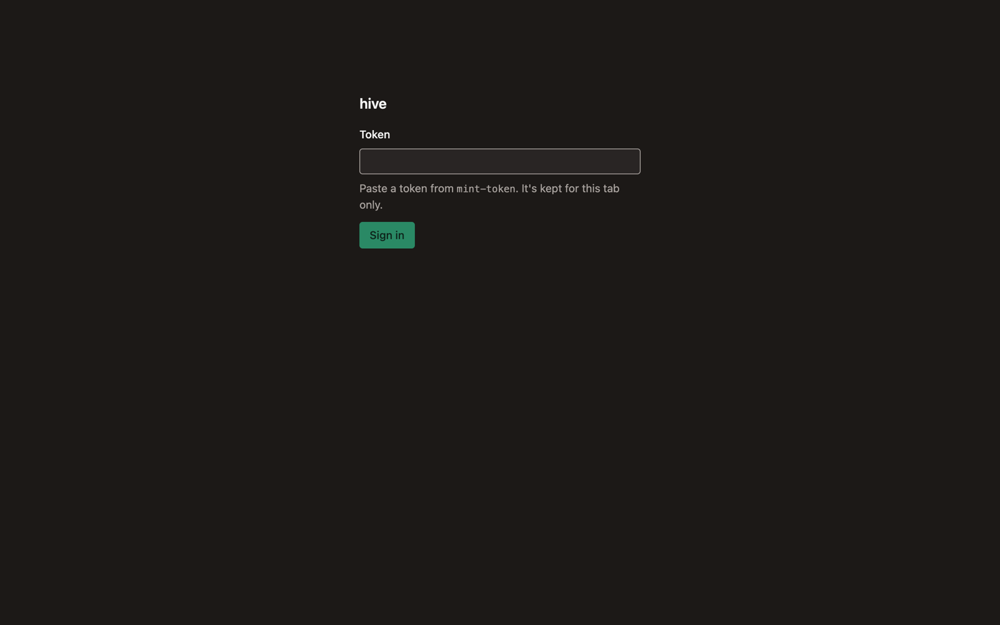
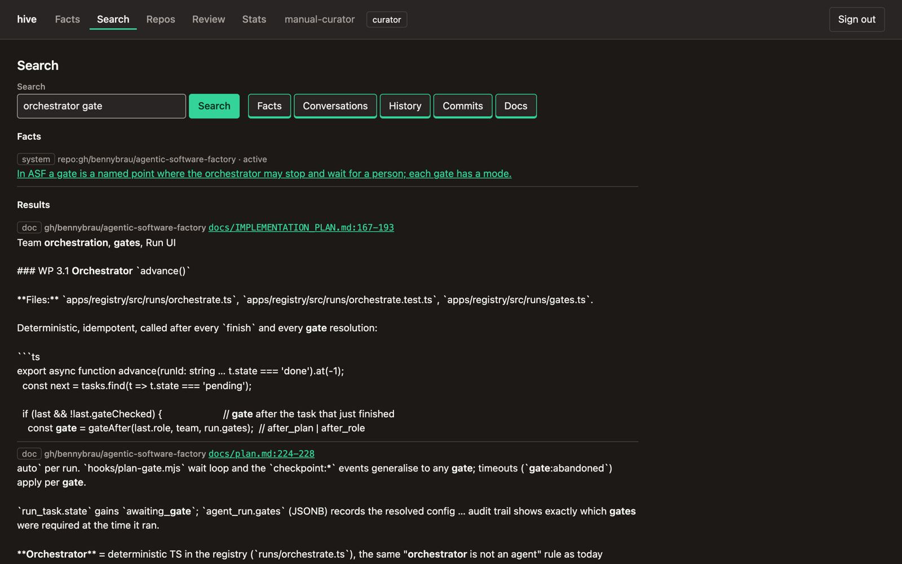

# Hive dashboard: user manual

The dashboard is the web view of your team's hive. You use it to **see what the hive knows**, **search it**, and,
as a curator, **decide what the hive is allowed to tell everyone's assistants**.

Most of the hive's work happens without you. Your Hermes sessions are recalled from and distilled into it
automatically. The dashboard is where a person looks in and decides.

- [Signing in](#signing-in)
- [Finding your way around](#finding-your-way-around): the menu and where each page lives
- [Words you'll see](#words-youll-see)
- [Facts](#facts): browse everything the hive knows
- [Search](#search): ask across facts, conversations, commits and docs
- [Repos](#repos): the code and docs the hive has read
- [Review](#review-curators): approve, fix or reject what's new (curators)
- [Stats](#stats-curators): cost, growth and health (curators)
- [Settings](#settings-curators): the daily review digest (curators)
- [Keyboard shortcuts](#keyboard-shortcuts)

## Who sees what

| | Member | Curator |
|---|---|---|
| Knowledge (Facts, Search), Admin › Sources (Repos) | ✓ | ✓ |
| **Ingest now** on Repos | | ✓ |
| Review (New, Out of date), Playbooks, Teams, Admin › Usage and cost (Stats), Admin › Notifications (Settings) | | ✓ |

Everyone sees shared facts (`global` and every `repo:…`) plus **their own** personal facts. Nobody, curators
included, ever sees another person's personal facts.

## Signing in



Open the hive's address in a browser, for example `http://hive.example.internal:8800/`, and paste
your token. Whoever runs the hive gives you one:

```sh
docker compose exec hive node dist/cli/mint-token.js --name <you>-laptop --user <you>              # member
docker compose exec hive node dist/cli/mint-token.js --name <you>-laptop --user <you> --role curator
```

- The token is kept **for this browser tab only**. Closing the tab signs you out; a new tab asks again.
- Your name and role are shown at the bottom of the menu. Click them to see which token you signed in with and to
  **Sign out**, which forgets the token.
- You can use the same token your Hermes plugin uses, or mint a separate one for the browser so it can be
  revoked on its own.

## Finding your way around

The menu runs down the left side. On a phone it sits behind the **Menu** button in the top bar.

| Menu item | Its pages (tabs along the top) | Who |
|---|---|---|
| **Knowledge** | [Facts](#facts), [Search](#search) | everyone |
| **Review** | New ([Review](#review-curators)), Out of date (facts nobody has used in a while) | curators |
| **Playbooks** | step-by-step instructions agents follow for a kind of task | curators |
| **Teams** | teams, their people and repos | curators |
| **Admin** | Sources ([Repos](#repos)), Usage and cost ([Stats](#stats-curators)), Notifications ([Settings](#settings-curators)) | everyone sees Sources; the rest is curators only |

A number next to **Review** is how many facts are waiting for a curator. The page addresses haven't changed
(`/facts`, `/review`, `/stale`, `/repos`, `/stats`, `/settings`), so old links and the daily digest's link still
work. The screenshots in this manual show the dashboard before the redesign; they are replaced as each page is
rebuilt.

## Words you'll see

The dashboard uses plain words. The word in brackets is the value the API and older screens use, shown here once
so you can match them up.

- **Fact**: one short statement the hive can tell an assistant, such as "The orchestrator gate waits for a person."
- **Kind**: what sort of fact it is: **Decision**, **Must stay true** (invariant), **Pitfall** (gotcha),
  **Preference**, **Convention** or **How it works** (system).
- **Who gets it** (scope): **Everyone** (global), **Repo:** and the repo name (`repo:<key>`), **Team:** and the team name, or
  **Just me** (personal), which only you see.
- **Status**:
  - **Waiting for review** (candidate): proposed, waiting for a curator; **not** given to assistants yet.
  - **Live** (active): approved, so assistants are given it.
  - **Replaced** (superseded): a newer fact took its place (kept as history).
  - **Retired** (retracted): withdrawn or rejected (kept as history).
- **Origin**: where it came from.
  - **Written by a person** (authored): someone wrote it, through Hermes or the API.
  - **Learned from a conversation** (distilled): the hive-worker proposed it from something a person said.
  - **Read from the repo** (ingested): taken from a repo's docs or code.
- **Where this comes from** (anchors): the evidence behind a fact, either a quote from a file at a line or a quote
  from a conversation. The hive re-checks file quotes and says whether the source **Still matches** (verified),
  **Source changed** (drifted), **Source gone** (missing), **Can't check from here** (unverifiable_here) or
  **Not checked yet** (unverified). See [anchor health](#anchor-health).

How a fact goes live:

- Facts for **Just me** are live at once.
- Shared facts written by a **curator** are live at once.
- Shared facts written by a **member**, and everything **learned from a conversation**, start as **Waiting for
  review** in [Review](#review-curators).

## Facts


Every fact agents are given, and where each one came from: everything you can see, newest first, 50 per page.
Dates read as "3 hours ago" or "Nov 7"; hover one for the full date and time.

**Filters** along the top narrow by who gets it, repo, status, origin and kind. The filters are kept in the page
address, so you can bookmark or share a filtered view. When nothing matches, the page says so and explains how
facts get here.

**Search** on this page finds facts by meaning, not just by matching words. Up to 100 matches, ranked by relevance,
and still narrowed by the filters. Facts waiting for review are included. For conversations, commits and docs, use
the [Search](#search) page.

**Click a row**, or move with `j`/`k` and press `Enter`, to open the fact on the right:

- Its kind, who gets it, status (with any note) and origin.
- **Where this comes from**: each piece of evidence with its quote and its [health badge](#anchor-health). A file
  quote links to the exact lines on GitHub, at the commit the hive last read (shown as its first 7 characters).
  If the quote has moved, it says where it is now.
- **Supersedes / Superseded by**: the chain of older and newer versions of this fact, each with its status. Click
  one to open it.
- **Reviews**: who approved, fixed or rejected it, when, and why.
- **Details** (closed until you click it): the fact's id, its author, the full time it was recorded, and the files
  or areas it is about (locus).

`Esc` closes the panel. The open fact is part of the page address, so a link opens straight to it.

## Search



Search facts, docs, commits and past conversations at once. Type a question or a few words and press `Enter`.

**Sources** are the chips under the box. Click them to switch each one on or off:

- **Facts**: shown first, in their own section, with kind, who gets it and status.
- **Conversations**: single turns from your past Hermes sessions.
- **History**: your whole past Hermes sessions.

Conversations and History only ever show **your own** sessions, never a teammate's.
- **Commits**: commit messages, with the commit's first 7 characters and its subject.
- **Docs**: chunks of the repos' documents, linked to the file and lines on GitHub.

Each source returns its best 20 results. Results mix meaning (embeddings) with keywords, so an exact name or
error message works as well as a plain-English question. Facts show their status, so facts waiting for review are
easy to spot. Click a fact to open it on the Facts page.

## Repos


The repositories the hive reads. For each one:

- **Key and path**: e.g. `gh/bennybrau/agentic-software-factory` and where it's checked out on the hive's host.
- **Ingested … at `abc1234`**: when the hive last read it and at which commit. The hive always reads the
  repo's **default branch** as last fetched from origin, not whatever branch happens to be checked out. It
  re-reads every 15 minutes by default.
- **Counts**: documents, chunks (searchable pieces of documents) and commits indexed.
- **Last ingest failed: …**: appears only when the last read went wrong.

### Anchor health

The badges show how the hive's evidence in this repo holds up against the files as they are now:

- **verified**: the quote is still there (it may have moved; the fact panel says where).
- **drifted**: the quote isn't there word for word, but a close match is. The source was edited, and the
  fact may need updating.
- **missing**: the file is gone, or nothing like the quote is left. A fact read from docs is retracted
  automatically if this persists. A fact someone wrote is never retracted; it's left for a person to look at.
- **unverifiable here**: nothing this hive can check.
- **unverified**: not checked yet.

### Buttons

- **Files not indexed**: lists documents the hive considered but didn't index (empty, skipped or failed) and
  why. Use it when a doc you expected doesn't show up in Search.
- **Ingest now** (curators): read the repo right away instead of waiting for the next sync. It's disabled while a
  read is running. When done it shows a summary: docs indexed, unchanged and removed, new commits, and the result of
  re-checking every anchor.

Registering a new repo is done through the API (`POST /v1/repos`) for now, not in the dashboard.

## Review (curators)


Hive proposes facts from what people say. Nothing reaches an agent until a curator approves it. **New** shows
the facts waiting for review **one at a time**, oldest first (facts someone asked Hive to remember come first).
**Level** at the top right narrows the queue to one level.

Each card, top to bottom:

- **Fact n of N**, with **‹ ›** to move to the previous or next fact.
- What kind of fact it is, where it came from (for example **Learned from a conversation**), and **asked to
  remember** if someone asked for it.
- The proposed fact, in large type.
- **Who gets it**: the level it would be approved for and what that means. **Change…** opens **Who should get
  this?** in place, so you can approve it for another repo, a team or everyone instead.
- **Why Hive thinks so**: what the person said, with who said it, where (for example "in a factory plan approval")
  and when. Hover the time for the full date. Without a conversation it shows the passage the fact quotes, or the
  file and lines.
- **Replaces**, if the fact would replace one that is live now: approving or editing retires the old one.
- Folded until you open them: **The agent said** (what the agent said just before), **Similar live facts** (up to 3
  that say nearly the same thing, with a similarity percentage: if one already covers it, reject or edit to match),
  and **Details** (the fact's id, when it was recorded, the conversation, and every place it comes from with whether
  that still matches).

Below the card, **Corrected after citation** lists live facts someone corrected after an answer cited them, with
**Keep**, **Fix** and **Retire**. **Replaced by a new fact** links to the card that would replace it.

### Deciding

The buttons at the bottom of the card:

- **Approve for** *level*: the fact goes live and agents start getting it, at the level shown (change it with
  **Change…** first).
- **Edit…**: change the text, then **Save and approve** (or `Enter`; `Shift+Enter` for a new line, `Esc` cancels).
- **Reject**: an optional reason, then **Reject** again (or `Enter`; `Esc` cancels).
- **? keys** shows the keyboard shortcuts.

- **On a phone** the buttons stay at the bottom of the screen while you scroll the card: **Approve** across the
  full width, **Edit…** and **Reject** side by side under it.
- **Undo**: every decision waits **5 seconds** before it is saved, with an **Undo** button. Making the next
  decision, or leaving the page, saves the previous one at once.
- **Editing into an existing fact**: if your edited text is word for word an existing fact at that level, the
  fact is **merged** into it. Its evidence moves to that fact and this one is closed.
- When nothing is waiting, the page says **Nothing waiting for review** and when Hive last learned from
  conversations. If that was long ago and people have been working, check the worker on [Stats](#stats-curators).
- If a decision can't be saved, the fact comes back with the error.

## Out of date (curators)

**Review › Out of date** shows live facts no agent has used for a while (60 days unless the hive is set up
differently; the line under the title says how long and how many). Pinned facts never show here. It uses the same
card as [Review](#review-curators), **one fact at a time**, with **Fact n of N** and **‹ ›**, the fact, **Who gets
it** and **Change…**.

**Why Hive thinks so** says how long nobody has used it and when it was last used ("Nobody has used it in 60 days.
Last used Mar 3."), or, if no agent ever used it, when it was added. Hover the time for the full date. **Details**
(folded) has how many times agents were given it (**Uses**) and cited it (**Cites**), and its id.

The buttons at the bottom of the card:

- **Keep**: it is still right; it leaves the list until nobody uses it for that long again.
- **Move…**: **Who should get this?**, **Just me** included, then **Move to** *level*. Picking a level from
  **Change…** does the same.
- **Retire**: an optional reason, then **Retire fact** (or `Enter`; `Esc` cancels). Agents stop getting it.
- **Edit…**: change the text, then **Save fix** (or `Enter`; `Esc` cancels). The new text replaces the old fact.
- **Pin**: keep it and never show it here again.

Each one is saved at once (there is no Undo here) and the next fact shows. When nothing is out of date, the page
says **Nothing is out of date**. Moving a fact to a level that already has the same text merges it into that fact,
and the page says so.

## Stats (curators)


Pick a window of **7, 30 or 90 days**.

- **Cost**: model calls per job (`distill` = turning conversations into candidates, `embed` = making text
  searchable), with input/output tokens and estimated cost, in total and per day. With local embeddings (Ollama)
  `embed` is $0.
- **Facts**: how many facts there are by status, origin and scope, and how many were recorded each day.
- **Workers**: each hive-worker and when it last checked in. **stale** means it hasn't been seen for 10
  minutes, so conversations aren't being distilled.
- **Backlog**: candidates waiting for review and conversations waiting to be distilled, each with the age of the
  oldest. A growing distill backlog with a stale worker means the worker is down.

## Settings (curators)

**Daily review digest** is a short message, once a day, saying what is waiting in [Review](#review-curators),
with a link to it. It goes by email, Telegram or both, and it is built for the curator who last saved the settings.

1. Turn on **Send the daily digest** and pick the **time** and **time zone**.
2. **Dashboard link** is where the digest's links point. It starts as the address you're using now.
3. Turn on **Send by email**, **Send by Telegram** or both, and fill in the fields below.
4. **Save**, then **Send test**. Each channel shows ✓ **Sent** or ✗ **Failed** with the reason. The test
   doesn't count as the day's digest. Unsaved changes can't be tested: save first.

Passwords and bot tokens are never shown again. A saved one reads **saved**; leave it blank to keep it, or type a
new one to replace it. Turning a channel off and saving forgets its password or token. Below the buttons you
see when the last digest went out, how many items it had, and its last error.

**Telegram.** Message [@BotFather](https://t.me/BotFather), send `/newbot`, and follow the prompts. It answers
with the **bot token** (like `123456:ABC-…`). Then find the **chat id**: send your new bot any message (or add it
to a group and post there), open `https://api.telegram.org/bot<token>/getUpdates` in a browser, and copy
`"chat":{"id": …}`. A group's id starts with `-`.

**Gmail.** Use host `smtp.gmail.com`, port `465`, **Secure connection** on, your Gmail address as the user, and an
**app password** (Google Account, Security, 2-Step Verification, App passwords) rather than your normal one.
Gmail refuses the normal password.

## Keyboard shortcuts

| Where | Key | Does |
|---|---|---|
| Facts | `j` / `k` (or arrows) | move through the table |
| Facts | `Enter` | open the selected fact |
| Facts | `Esc` | close the fact panel |
| Review | `j` / `k` (or `↓` / `↑`) | next / previous fact |
| Review | `a` | approve, for the level shown |
| Review | `f` | edit the text (Edit…) |
| Review | `r` | reject, with an optional reason |
| Review, editing | `Enter` / `Shift+Enter` / `Esc` | save / new line / cancel |

On Review, **? keys** under the card shows the same list.

Shortcuts are ignored while you're typing in a box.

## Troubleshooting

- **"The hive didn't accept that token."**: the token was revoked or mistyped. Ask for a new one.
- **"Couldn't reach the hive."**: the hive is down, or you're off the tailnet.
- **Review, Playbooks and Teams are missing from the menu, and Admin only has Sources**: your token is a member token.
- **A doc you expected isn't in Search**: open Repos → **Files not indexed**. Check that the change is on the
  repo's default branch and was fetched from origin.
- **No new candidates after a session**: check Stats → Workers (stale?) and Backlog.
